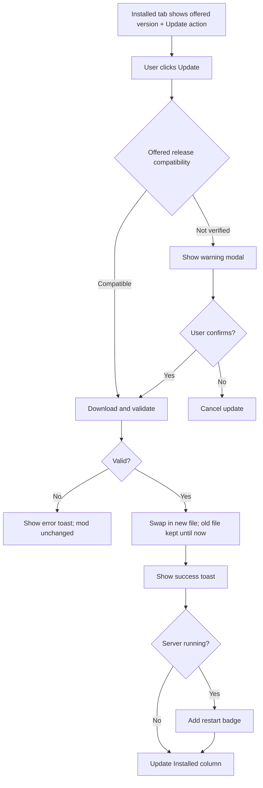

# Sprint Change Proposal: Mod Updates (Epic 14)

**Date:** 2026-11-09
**Author:** Matt
**Workflow:** correct-course (incremental review; all five edit proposals approved)
**Scope classification:** Moderate

## 1. Issue Summary

**Trigger:** New requirement. Mod updates were planned in the PRD from the start (success criteria, Journey 2 "Mod Update Day", Phase 2) and explicitly deferred in Epic 5, but never scheduled into an epic. All 13 epics are now done.

**Problem:** Admins can install, enable, disable and remove mods, but cannot see available updates, apply them, or return to an earlier version without removing and reinstalling.

**Evidence:**

- PRD success criteria promise "Install, update, version-switch mods" and "See available mod updates at a glance"; no functional requirements cover them.
- The mod detail page shows "Update to vX", but `install_mod` rejects any installed mod (`services/mods.py`, `ModAlreadyInstalledError`), so the button cannot succeed. Determined from code; not reproduced in a browser.
- The detail page decides an update exists with `installedVersion !== latestVersion`, which treats any non-latest version, including a deliberate rollback, as outdated.
- The `mod_cache_refresh` job already fetches every installed mod and discards the data; its own comment names storing the latest version as a future enhancement.
- The Epic 5 architecture `update(slug)` sequence removes the old version before installing the new one, which would leave a mod missing if the install failed.

**Scope decisions made during review:**

| Decision | Choice |
|---|---|
| Scope | Detection, one-click update, update all, scheduled checks with alerts, version rollback |
| Update target | Newest compatible newer release, else newest not-verified; none if only incompatible releases are newer |
| Update all | Compatible updates only; not-verified mods are skipped and reported |
| Alerts | In-app count badge plus an optional outbound webhook |

## 2. Impact Analysis

**Epic impact:** Epics 1-13 are done and none is invalidated. One new epic, Epic 14: Mod Updates, with 7 stories. No resequencing.

**Story impact:** No existing story changes. Story 10.6 (FR79) assumed an update capability that never existed; Story 14.3 delivers it.

**Artifact conflicts:**

| Artifact | Change |
|---|---|
| PRD | Add FR129-FR151; mark Phase 2 and growth items as Epic 14; update the Mods endpoint row; frontmatter |
| Epics | Add Epic 14; Post-MVP FR coverage rows; Story Summary row; mark Epic 5 deferred list as delivered; frontmatter |
| Architecture | New `architecture/epic-14-mod-updates.md`; index entry; supersede note on Epic 5 `update(slug)` |
| UX spec | Table columns, revised Mod Update Flow, Update All and Version Switch flows, components, phases, warnings, mobile |

**Technical impact:**

- New version change operation in `ModService` with download, validate, then atomic swap.
- New persisted state file `vsmanager/state/mod-updates.json`.
- Four new endpoints and three new error codes.
- `mod_cache_refresh` gains update recording; no new job or interval setting.
- New Admin-only secret setting for the webhook URL.
- MVP is unaffected. CI, deployment and test strategy need no changes.

**Known issue outside this change:** the epics.md Story Summary was already inaccurate before this proposal (it lists 3.5, 4.0 and 12.6, and omits 13.6 and 13.7), so its total does not match the 75 stories in sprint-status.yaml. This proposal does not correct it.

## 3. Recommended Approach

**Selected:** Option 1, Direct Adjustment: add Epic 14 within the existing structure.

| Option | Verdict |
|---|---|
| 1. Direct adjustment | Viable. Effort: Medium. Risk: Low-Medium |
| 2. Rollback of completed work | Not viable; nothing needs reverting |
| 3. PRD MVP review | Not needed; MVP is delivered |

**Rationale:**

- The feature extends established patterns: mod API client, artifact cache, atomic writes, `safe_job` scheduling, pending restart, TanStack Query.
- Treating update and rollback as one operation keeps the safety logic in one place.
- Reusing the existing refresh job adds no new load on the mod database.

**Risks and mitigations:**

| Risk | Mitigation |
|---|---|
| Partially applied update | Validate before swapping; old file stays until the new one is in place (ADR-2) |
| A release replaces a different mod | Validate that the archive's modid matches the installed mod |
| Release-order assumption is wrong | Story 14.0 verifies it against the live API first |
| Webhook URL leaks a token | Write-only setting, redacted reads, never logged, Admin only (ADR-6) |
| Replacing a file while the server runs | Story 14.0 tests it; restart is marked pending |

## 4. Detailed Change Proposals

### 4.1 PRD (`prd.md`)

**New section appended after FR128:**

```markdown
### Epic 14: Mod Updates

#### Update Detection

- FR129: System determines whether a newer release exists for each installed mod using the mod database's release order, not by comparing version strings
- FR130: The offered update is the newest newer release compatible with the current game version, or if none exists, the newest newer release that is not verified
- FR131: No update is offered when every newer release is incompatible with the current game version
- FR132: A mod not found in the mod database, or whose installed version is not listed there, shows its update status as unknown rather than up to date
- FR133: Admin and Monitor can view update status for installed mods, including offered version, its compatibility, and when it was last checked
- FR134: Admin can trigger an update check on demand

#### One-Click Update

- FR135: Admin can update a mod to its offered version with a single action
- FR136: Updating to a not-verified release requires confirming a warning
- FR137: The installed version stays in place until the new version is downloaded and validated; a failed update leaves the mod unchanged
- FR138: Updating or switching versions preserves the mod's enabled or disabled state
- FR139: If the game server is running, updating or switching versions marks a restart as pending

#### Version Switching

- FR140: Admin can switch an installed mod to any release listed in the mod database, including older releases
- FR141: Switching shows the target release's compatibility and warns before installing a not-verified or incompatible release, or a release older than the installed one
- FR142: Switching uses a cached copy of the release when available and downloads it otherwise

#### Update All

- FR143: Admin can update every mod that has a compatible update in a single action
- FR144: Update all skips mods whose offered update is not verified and reports them for individual review
- FR145: A failure updating one mod does not stop the others; results are reported per mod

#### Scheduled Checks and Alerts

- FR146: System checks for mod updates on the existing mod refresh interval; an interval of 0 disables scheduled checks
- FR147: Update status remains available after an API restart, without waiting for the next scheduled check
- FR148: Dashboard and Mods navigation show a count of mods with updates available
- FR149: Admin can configure an outbound webhook URL for update alerts; the URL is treated as a secret, is Admin-only, and is never logged or exposed to Monitor
- FR150: A webhook alert is sent once for each newly available update, not repeated on every check
- FR151: A webhook delivery failure is logged and does not affect update checks
```

**Phase 2 and growth lists:** append "(Epic 14)" to "Mod update detection and one-click updates", "Mod version switching (rollback capability)", "Scheduled mod update checks with notifications" and "Mod version switching (rollback to previous versions)".

**Endpoint table, Mods row:**

```
OLD: `/mods`, `/mods/{slug}`, `/mods/{slug}/update`, `/mods/{slug}/enable`, `/mods/{slug}/disable`, `/mods/check-updates`
NEW: `/mods`, `/mods/{slug}`, `/mods/updates`, `/mods/updates/check`, `/mods/updates/apply-all`, `/mods/{slug}/version`, `/mods/{slug}/enable`, `/mods/{slug}/disable`
```

**Frontmatter:** `lastUpdated: '2026-11-09'`; new `updates` entry "Added FR129-FR151 for Epic 14 (Mod Updates)".

**Rationale:** FR57 and FR79 already assumed an update capability. One `/version` endpoint replaces `/update` because update and rollback are the same operation.

### 4.2 Epics Structure (`epics.md`)

**Frontmatter:** `lastUpdated: '2026-11-09'`; new `updates` entry "Added Epic 14 (7 stories) for Mod Updates".

**Epic 5 deferred list:**

```
OLD: **Post-MVP (deferred):**
NEW: **Post-MVP (delivered by Epic 14):**
```

**Post-MVP FR Coverage Map, rows after FR128:**

```markdown
| FR129 | Epic 14 | Detect newer releases by release order |
| FR130 | Epic 14 | Offer newest compatible release |
| FR131 | Epic 14 | No offer when only incompatible releases are newer |
| FR132 | Epic 14 | Unknown status for unlisted mods or versions |
| FR133 | Epic 14 | View mod update status |
| FR134 | Epic 14 | On-demand update check |
| FR135 | Epic 14 | One-click mod update |
| FR136 | Epic 14 | Warning before not-verified update |
| FR137 | Epic 14 | Failed update leaves mod unchanged |
| FR138 | Epic 14 | Preserve enabled state across version change |
| FR139 | Epic 14 | Pending restart on version change |
| FR140 | Epic 14 | Switch to any listed release |
| FR141 | Epic 14 | Warnings when switching versions |
| FR142 | Epic 14 | Reuse cached release, otherwise download |
| FR143 | Epic 14 | Update all compatible mods |
| FR144 | Epic 14 | Update all skips and reports not-verified mods |
| FR145 | Epic 14 | Per-mod results, failures isolated |
| FR146 | Epic 14 | Scheduled update checks |
| FR147 | Epic 14 | Update status survives API restart |
| FR148 | Epic 14 | Update count on Dashboard and navigation |
| FR149 | Epic 14 | Admin-only webhook URL treated as a secret |
| FR150 | Epic 14 | One webhook alert per new update |
| FR151 | Epic 14 | Webhook failures isolated from checks |
```

**Story Summary:**

```
OLD: | **Total** | | **71** |
NEW: | Epic 14: Mod Updates | 14.0, 14.1, 14.2, 14.3, 14.4, 14.5, 14.6 | 7 |
     | **Total** | | **78** |
```

### 4.3 Epic 14 Stories (appended to `epics.md`)

```markdown
## Epic 14: Mod Updates

**Goal:** Admins can see when installed mods have updates, apply them individually or together, switch to any listed release, and be alerted when new updates appear.

### Current State

- Mods can be installed, enabled, disabled and removed
- Installing an already-installed mod is rejected, so the detail page's Update button cannot succeed
- The mod refresh job fetches data for installed mods but discards it

### Target State

- Installed mods show their update status and offered version
- Update and version switching are one safe operation that leaves the mod unchanged on failure
- Scheduled checks drive an in-app count badge and an optional webhook alert

---

### Story 14.0: Epic 14 Technical Preparation

As a **developer**,
I want **mod release behavior verified against the live mod database**,
So that **update logic rests on confirmed behavior**.

**Acceptance Criteria:**

**Given** the live mod API
**When** releases are inspected for several mods
**Then** findings document release ordering, whether old releases remain listed, and how filenames vary between versions

**Given** a mod file is replaced while the game server is running
**When** the behavior is tested
**Then** findings document whether replacement is safe before a restart

**Given** common webhook receivers
**When** payload requirements are researched
**Then** a payload format is documented that works with Discord and generic receivers

**Tasks:**
- [ ] Verify release ordering and history against the live API
- [ ] Test replacing a mod file while the server runs
- [ ] Define the webhook payload
- [ ] Update architecture documentation with findings

---

### Story 14.1: Update Detection and Status API

As an **administrator**,
I want **to see which installed mods have updates**,
So that **I know what can be updated without checking each mod**.

**Acceptance Criteria:**

**Given** an installed mod has newer releases
**When** update status is determined
**Then** release order from the mod database identifies them, without comparing version strings
**And** the offered update is the newest compatible release, or if none, the newest not-verified release

*(Covers FR129, FR130)*

**Given** every newer release is incompatible with the current game version
**When** update status is determined
**Then** no update is offered

*(Covers FR131)*

**Given** a mod or its installed version is not listed in the mod database
**When** update status is determined
**Then** its status is unknown, not up to date

*(Covers FR132)*

**Given** I am an Admin or Monitor
**When** I request `GET /api/v1alpha1/mods/updates`
**Then** I receive each mod's status, offered version, compatibility and last-checked time

*(Covers FR133)*

**Given** I am an Admin
**When** I request `POST /api/v1alpha1/mods/updates/check`
**Then** status is refreshed from the mod database
**And** a Monitor receives 403

*(Covers FR134)*

**Given** update status has been stored
**When** the API restarts
**Then** the last known status is still returned

*(Covers FR147)*

**Given** the mod database is unavailable
**When** a check runs
**Then** the previous status is preserved and the failure is reported

**Tasks:**
- [ ] Implement release-order detection and offered-version selection
- [ ] Persist update status with atomic writes
- [ ] Add status and check endpoints with role enforcement
- [ ] Add tests for each status outcome and API failure

---

### Story 14.2: Version Change API

As an **administrator**,
I want **a mod moved safely to a chosen version**,
So that **a failed update never leaves me without a working mod**.

**Acceptance Criteria:**

**Given** an installed mod and a release listed in the mod database
**When** I request `PUT /api/v1alpha1/mods/{slug}/version`
**Then** the release is obtained from cache if present, otherwise downloaded
**And** the installed file is replaced only after the new file is validated

*(Covers FR135, FR140, FR142)*

**Given** a download or validation failure
**When** the version change fails
**Then** the original file and state are unchanged
**And** a specific error code is returned

*(Covers FR137)*

**Given** the mod is disabled
**When** its version changes
**Then** it remains disabled

*(Covers FR138)*

**Given** the server is running
**When** a version change succeeds
**Then** a restart is marked as pending

*(Covers FR139)*

**Given** the target release is not verified, incompatible or older than the installed version
**When** the request does not include explicit confirmation
**Then** the request is rejected with the compatibility details

*(Covers FR136, FR141)*

**Given** a version change is in progress for a mod
**When** another change is requested for that mod
**Then** the second request is rejected with 409

**Tasks:**
- [ ] Add a version change operation to ModService
- [ ] Reuse the download, validation and atomic replacement patterns
- [ ] Add error codes to `models/errors.py`
- [ ] Add the endpoint, Admin only
- [ ] Add tests for failure at each stage, disabled mods and concurrency

---

### Story 14.3: Update and Version Switching UI

As an **administrator**,
I want **to update or switch a mod's version from the UI**,
So that **I can manage versions without touching files**.

**Acceptance Criteria:**

**Given** a mod has an offered update
**When** I view the Installed tab
**Then** I see the installed and offered versions with an Update action, on desktop and mobile layouts

**Given** the offered update is compatible
**When** I click Update
**Then** the mod updates without further confirmation and I see a success toast

*(Covers FR135)*

**Given** the offered update is not verified
**When** I click Update
**Then** a warning must be confirmed first

*(Covers FR136)*

**Given** a mod's status is unknown
**When** I view the Installed tab
**Then** it is shown as unknown, not as up to date

**Given** an installed mod
**When** I open its detail page
**Then** the Update button succeeds
**And** I can select any listed release, with warnings for not-verified, incompatible or older releases

*(Covers FR79, FR140, FR141)*

**Given** an update fails
**When** the error is returned
**Then** I see an error toast and the mod is shown unchanged

**Tasks:**
- [ ] Add update status and version change hooks with query invalidation
- [ ] Add version information and the Update action to the Installed tab
- [ ] Add confirmation dialogs
- [ ] Connect the detail page Update button and version selector to the new endpoint
- [ ] Add component tests
- [ ] Manual browser verification

---

### Story 14.4: Update All

As an **administrator**,
I want **to apply all compatible updates at once**,
So that **routine updates take a single action**.

**Acceptance Criteria:**

**Given** mods have compatible updates
**When** I request `POST /api/v1alpha1/mods/updates/apply-all`
**Then** each is updated using the version change operation
**And** results are returned per mod

*(Covers FR143, FR145)*

**Given** a mod's offered update is not verified
**When** update all runs
**Then** it is skipped and reported for individual review

*(Covers FR144)*

**Given** one mod fails to update
**When** update all continues
**Then** the remaining mods are still processed

*(Covers FR145)*

**Given** I click Update All in the UI
**When** the confirmation appears
**Then** it lists what will be updated and skipped
**And** afterwards I see a per-mod summary and at most one restart prompt

**Tasks:**
- [ ] Add the apply-all endpoint, Admin only
- [ ] Re-evaluate each offered version when applying
- [ ] Add the Update All action, confirmation and summary
- [ ] Add API and component tests
- [ ] Manual browser verification

---

### Story 14.5: Scheduled Checks and Update Badges

As an **administrator**,
I want **updates found automatically and shown at a glance**,
So that **I notice them without checking**.

**Acceptance Criteria:**

**Given** `mod_list_refresh_interval` is greater than 0
**When** the refresh job runs
**Then** update status is recorded for each installed mod
**And** a failure for one mod does not affect the others

*(Covers FR146)*

**Given** `mod_list_refresh_interval` is 0
**When** the scheduler starts
**Then** no scheduled checks run
**And** on-demand checks still work

*(Covers FR146)*

**Given** updates are available
**When** I view the Dashboard or navigation
**Then** I see the count of mods with updates
**And** selecting it takes me to the Installed tab

*(Covers FR148)*

**Given** no updates are available
**When** I view the Dashboard or navigation
**Then** no count is shown

**Tasks:**
- [ ] Extend `mod_cache_refresh` to record update status
- [ ] Add the count to the Dashboard and Mods navigation
- [ ] Add job and component tests
- [ ] Manual browser verification

---

### Story 14.6: Webhook Alerts

As an **administrator**,
I want **an alert sent to my chat when updates appear**,
So that **I find out without opening the UI**.

**Acceptance Criteria:**

**Given** I am an Admin
**When** I save an http or https webhook URL in API settings
**Then** it is stored and later shown only as configured or not configured
**And** the URL is never logged or returned to a Monitor

*(Covers FR149)*

**Given** a check finds a newly available update
**When** a webhook is configured
**Then** one alert is sent for that mod and version
**And** later checks do not repeat it, including after an API restart

*(Covers FR150)*

**Given** webhook delivery fails or times out
**When** the job continues
**Then** a failure is logged without the URL
**And** update checks are unaffected

*(Covers FR151)*

**Tasks:**
- [ ] Add the webhook setting with redacted reads
- [ ] Add a settings UI field
- [ ] Send alerts without following redirects, and record what was sent
- [ ] Add tests for deduplication, redaction and failure
- [ ] Manual browser verification
```

### 4.4 Architecture

**New file `architecture/epic-14-mod-updates.md`:**

```markdown
# Epic 14: Mod Updates Architecture

_Added during the Epic 14 course correction (2026-11-09). Story 14.0 verifies the assumptions marked below._

## ADR-1: Detect Updates by Release Order

**Decision:** A release is newer than the installed one if it appears earlier in the mod database's release list, which is ordered newest first. Version strings are never compared.

**Rationale:** Mod versions are free-form. The detail page's current `!==` comparison reports any non-latest version as outdated, including a deliberate rollback.

**Consequences:** If the installed version is not in the list, the status is `unknown`. The offered release is the newest newer compatible release, then the newest newer not-verified release, otherwise none (`blocked`). Story 14.0 verifies the ordering assumption.

## ADR-2: One Version Change Operation

**Decision:** Update and rollback use one `ModService` operation that moves a mod to a given listed release. It replaces the Epic 5 `update(slug)` sequence, which removed the old version before installing the new one.

**Sequence:**
1. Resolve the release from the mod database
2. Use the cached file in `vsmanager/cache/mods/` if present, otherwise download it there
3. Validate the archive and confirm its `modid` matches the installed mod
4. Copy into the mods directory under a temporary name, then rename into place, keeping `.disabled` if the mod is disabled
5. Update and save mod state, then delete the old file if its name differs
6. Mark a restart as pending if the server is running

A failure before step 4 completes leaves the original file and state untouched. Changes are serialized per mod; a concurrent request for the same mod returns 409.

## ADR-3: Rollback Source

**Decision:** Rollback uses the mod database's release list and the existing artifact cache. No extra retention policy is added, and cache eviction is unchanged.

**Consequences:** A release removed from the mod database can only be restored while its file is still cached.

## ADR-4: Update Status Store

**Decision:** Checks write `vsmanager/state/mod-updates.json` atomically. Per mod it holds the release list (versions and game version tags, in order), the computed status, the offered release and `checked_at`. It also records the alerts already sent.

**Rationale:** Status survives restarts (FR147). Storing the release list lets status be recomputed locally when the game version changes or a mod is installed, removed or switched, without calling the mod database.

## ADR-5: Scheduled Checks Reuse the Refresh Job

**Decision:** `mod_cache_refresh`, which already fetches every installed mod on `mod_list_refresh_interval` (default 14400 seconds), records update status. No new job or setting is added, and an interval of 0 disables it.

## ADR-6: Webhook Alerts

**Decision:** An Admin-only `mod_update_webhook_url` in API settings.
- **Reads:** return only whether it is configured; the URL is never returned, logged or exposed to Monitor.
- **Sending:** http or https only, a 10 second timeout, and no redirects followed.
- **Payload:** a Discord-compatible `content` message plus a structured `updates` list. Story 14.0 confirms this.
- **Deduplication:** one alert per mod and version, recorded in the status store.
- **Failure:** delivery failures are logged without the URL and never fail the job.

**Consequences:** The URL is stored in plain text in `api-settings.json` on the data volume, the same trust boundary as the rest of the server's state.

## API Additions

| Method | Path | Role | Purpose |
|---|---|---|---|
| GET | `/mods/updates` | Admin, Monitor | Update status for installed mods |
| POST | `/mods/updates/check` | Admin | On-demand check |
| POST | `/mods/updates/apply-all` | Admin | Update all compatible mods |
| PUT | `/mods/{slug}/version` | Admin | Change version; body: `version`, `confirm` |

Literal routes are declared before `/{slug}` routes.

**New error codes:**
- `MOD_CONFIRMATION_REQUIRED`: the target is not verified, incompatible or older, and `confirm` is false
- `MOD_VERSION_CHANGE_IN_PROGRESS`: 409
- `MOD_VALIDATION_FAILED`: the archive is invalid or its modid doesn't match

The existing `MOD_VERSION_NOT_FOUND` covers unlisted releases.

## Frontend

- **Query key:** update status gets its own key under `mods` that cannot collide with a mod's detail key.
- **Invalidation:** version change and update all invalidate both installed mods and update status.
```

**`architecture/index.md`:** add an "Epic 14: Mod Updates Architecture" entry with links to each ADR, after the Epic 13 entry.

**`architecture/epic-5-mod-management-architecture.md`:** under the `update(slug)` branch in Mod Service Boundaries, add "Superseded by Epic 14 ADR-2."

### 4.5 UX Specification (`ux-design-specification.md`)

**Mod Table Columns:**

```
OLD: - Available (latest version with update indicator)
     - Actions (disable, remove)
NEW: - Available (offered update with Update action, or "Up to date", "Unknown", or "No compatible update")
     - Actions (disable, remove; version switching is on the mod detail page)
```

**Mod Update Flow:** replace the entry point and diagram:

````markdown
**Entry Points:**

- Game Server → Mods → Installed tab: Update action in the Available column
- Update count badge on the Dashboard and Mods navigation (links to the Installed tab)

**Flow Diagram:**



Incompatible newer releases are never offered as updates. They remain selectable on the detail page with a warning.
````

**Success criteria additions:** "A failed update never leaves the mod broken"; "An unknown status is never shown as up to date".

**New flows after Mod Update Flow:**

```markdown
### Update All Flow

- Entry: "Update All" button on the Installed tab, shown when compatible updates exist
- Confirmation lists the mods to update and those skipped as not verified
- Mods update one at a time; one failure doesn't stop the rest
- Result summary per mod (updated, skipped, failed), then a single restart prompt

### Version Switch Flow

- Entry: mod detail page, release selector next to the installed version
- Each release shows its compatibility badge
- Older releases show a downgrade warning; not-verified and incompatible releases show the matching warning modal
- After switching, the same success, error and restart feedback as an update
```

**VersionCell anatomy:**

```
OLD: - Anatomy: Installed version + Available version + Update badge when outdated
NEW: - Anatomy: Installed version + offered version + Update action, or a status label (Up to date, Unknown, No compatible update)
```

**New component:**

```markdown
**UpdateCountBadge**

- Purpose: Count of mods with updates, on the Dashboard and Mods navigation
- Implementation: Informational (blue) Badge, hidden when the count is 0
```

**Implementation phases:** append "(Epic 14)" to "VersionCell with inline update", and "(Epic 14, mod detail page)" to "Version selector dropdown".

**Compatibility Warnings table, new rows:**

```markdown
| Update to not-verified release | Warning modal with "Update Anyway" option |
| Switch to an older release | Warning modal noting the downgrade |
| Switch to an incompatible release | Red warning modal before switching |
| Update all | Confirmation listing updates and skipped mods |
```

**Mobile patterns:** add "Mod cards show the Update action and status label".

**Rationale:** the old flow had no path for incompatible releases, used the "Mods table" entry point from before Epic 11, and had no rollback or update all. Updating from the table and switching versions on the detail page are distinct actions, which preserves the spec's "one path per action" rule.

## 5. Implementation Handoff

**Scope:** Moderate. New epic and backlog additions, no fundamental replan.

| Role | Responsibility |
|---|---|
| Product Owner / Scrum Master | Apply the approved edits to PRD, epics, architecture and UX documents; add Epic 14 and its stories to sprint-status.yaml with `just sprint add-story`; create story files with `create-story`, starting with 14.0 |
| Development team | Implement stories in order (14.0 first, since 14.1 and 14.2 rely on its findings) with `dev-story`, then `code-review` |
| Product Manager / Architect | No escalation needed; review Story 14.0 findings and update ADRs if an assumption fails |

**Sequencing:** 14.0 → 14.1 → 14.2 → 14.3 → 14.4 → 14.5 → 14.6. Story 14.4 depends on 14.1 and 14.2. Stories 14.5 and 14.6 depend on 14.1's status store, and 14.6 sends alerts from the checks that 14.1 and 14.5 run.

**Success criteria:**

- FR129-FR151 implemented with tests; `just check` passes
- A failed update or version switch leaves the mod unchanged (tested at each stage)
- The mod detail page Update button works
- The webhook URL never appears in logs or Monitor responses
- Story 14.0 findings recorded in the Epic 14 architecture document
